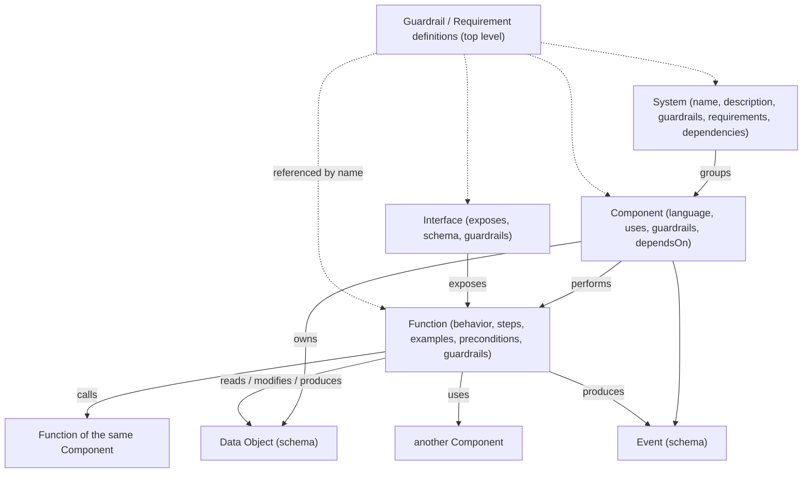
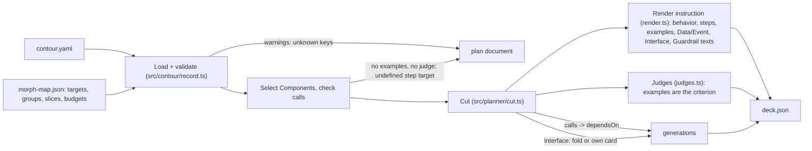
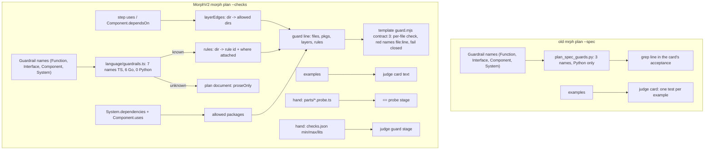

# The Contour in Morph

> 11.10.2026. Every claim cites `file:line` or a commit. V2 line numbers are at commit `120a849`
> (main, P31b merged; P31c added on top). Old Morph lines are at the `mrph` checkout of that day.
> Anything not checked against code or a run is marked **unverified**. The planning and history files
> cited here (`docs/PLAN.md`, `docs/DECISIONS.md`, `docs/AUTONOMY.md`, `docs/TASK_P*`) are on the
> development branch `main`, not on `production`.
> Prefixes: `mrph/` = `MorphProject/mrph`, `lab/` = `MorphProject/morph-lab`, no prefix = MorphV2.

## 1. What the Contour is

Contour is Mykhailo Kulish's framework for describing what a system does before any code exists.
It has seven element types and nine relations (`mrph/contour-reference/contour.md:208-255`):

- **System** groups **Components**. A Component is one lifecycle: one deployable, usually one team.
- A Component performs **Functions**, owns **Data Objects**, raises **Events**, and exposes
  Functions through **Interfaces**. **Actors** are outside callers.
- Relations: `groups`, `performs`, `exposes`, `uses` (across an Interface, never inside a
  Component), `calls` (inside one Component), `produces/consumes`, `reads/modifies`,
  `owns/references`, `depends-on` (Component to Component).
- **Requirements** (what an element must achieve) and **Guardrails** (where the implementation
  must stop) are named definitions. Elements reference them by name
  (`contour.md:506-566`). The author says both are "enforced, not declarative": each one must be
  checked by a test or by grading (`contour.md:568-578`).

A Function's ordered `steps` use five verbs: `calls`, `reads`, `modifies`, `produces`, `uses`
(`mrph/contour-reference/contour.schema.json:94-98`). The author's schema has
`additionalProperties: false` (`contour.schema.json:7`) and no `examples` key.

**Morph's record format** is "a Contour record plus two fields of ours": a top-level `version`
and per-Function `examples` `{given, when, then, ref?}` (`mrph/cards/record.py:1-14`,
`mrph/documentation/RECORD.md:15-18`, `:44-63`). RECORD.md calls examples the record's
**acceptance layer**, "the concrete numbers a test can check" (`RECORD.md:52`). Old Morph also
added Component `language` (`RECORD.md:65-69`).

**V2's extensions** (`src/contour/types.ts:1-27`, `src/contour/record.ts:22-40`):

| key | where | meaning in V2 |
|---|---|---|
| `preconditions` | Function | rendered in the card and in the judge's "Preconditions" block (`src/planner/render.ts:91-93`, `src/planner/judges.ts:64-81`) |
| `dependencies` | System | third-party libraries with an exact version, a language and an optional doc (`record.ts:324-346`) |
| `uses` | Component | names of declared dependencies only (`record.ts:230-263`); this is a second meaning of Contour's `uses` |
| `language` | Component | profile; default `typescript` (old Morph: `python`) |
| `examples` | Function | optional since P34a; if present, at least one (`record.ts:409-430`) |

Step `uses: <Component>` keeps Contour's meaning and, since P30, is a layer edge (§4).



## 2. The principle: one source, and only what it cannot say beside it

Old Morph's planner task (27.09) states the rule. Two hand-cut decks (ccledger, contour-engine)
showed the cut is mechanical: Function → card, `calls` → `depends_on`, Interface → last-generation
card, Guardrail → acceptance guard. What a rule cannot say (which Functions share a file, file names,
layer cards like `store`) "is a separate input file" (`lab/documentation/TASK_plan_spec.md:9-17`).
Note that the proven decks (ccledger 6/6, contour-engine 8/8, 27.09) were **cut by hand** from
their records (`TASK_plan_spec.md:9-13`). `plan --spec` was built afterwards and reproduced them as
its golden pairs, "without a single field added to the map" (`TASK_plan_spec.md:136-150`, `:202-205`,
`:239-241`). ccledger's record had no `examples` at the time; they were added later
(`docs/PLAN.md:80-84`).
That file is the **map**. RECORD.md §5 lists what it may hold: files, groups, extra cards, budgets and
slices, a fallback `language` (`mrph/documentation/RECORD.md:83-96`).

V2 keeps the rule in the orchestrator skill. Beside the record lives only placement (map targets,
slices, budgets) and one phase's inputs (spec, fixtures, probes, stubs, judge bounds). A project rule
("who imports whom, what is pure, which imports are allowed") belongs in the record. Writing it
elsewhere "is a defect of Morph" (`.claude/skills/morph-v2-orchestrator/SKILL.md:33-36`). Issue #42's
ledger item 7 repeats it.

**Why it matters.** In MorphStudio P9a the record gained a Component `users` and the hand table
`decks/tools/layers.json` did not. Every `users` card went red at `guard: users is not a package of
decks/tools/layers.json`. No answer could fix that, and one run was lost (issue #41 "Why";
issue #40 item 2; `docs/TASK_P30_rules.md:10-13`). A second copy of the record fails silently until
a run pays for it.

V2's own record rules: the record keeps only the current contract, no history (`docs/PLAN.md:912`).
Large literals go to `tests/fixtures/` by `ref` (`PLAN.md:914`). A Component stays at most 30 000 raw
bytes (`SKILL.md:110-114`). The Contour author's advice (06.10) behind these rules is at `PLAN.md:900-916`.

## 3. INPUT: how a record becomes a deck

`morph plan --spec contour.yaml --map morph-map.json --component <C> --judge` (`src/cli/planCommand.ts:36-195`):

1. **Load** (`src/contour/load.ts:50-61`, `record.ts:73-114`). Every problem is listed at once. Since
   P34a (#44, closed) an unknown key is a warning `"<path>: unknown key '<k>' (ignored)"`, not an
   error (`record.ts:127-131`). Missing `behavior`/`examples` no longer refuses the record. Every
   problem is still a plan error with exit code 2 (`planCommand.ts:55-58`).
2. **Select** Components by name or slug (`src/contour/select.ts:11-30`). **Links**: `calls` must name a
   Function of the same Component, and calling yourself is an error (`select.ts:43-51`).
3. **Cut** (`src/planner/cut.ts:73-260`):
   - Function → unit, or a map group → one unit (`cut.ts:24-57`);
   - `calls` → `dependsOn` (`cut.ts:118-121`);
   - an Interface that exposes one Function folds into that Function's card; one that exposes several
     gets its own card that depends on every owner (`cut.ts:143-168`);
   - default slice = map `docs` + the code targets of dependencies (`cut.ts:193-201`). The record file
     is never put in a slice (`src/planner/plan.ts:82`, `:179-181`; old: `mrph/cards/plan_spec.py:101-115`);
   - a Component that uses a dependency of another language is an error (`cut.ts:82-91`). A dependency
     doc must exist and is added to slices (`plan.ts:88-97`, `:156-177`).
4. **Render** the instruction from the record text, verbatim (`src/planner/render.ts`). It holds the
   description, `Behaviour:`, Preconditions, Steps, numbered Examples, Data/Event blocks for
   `reads/modifies/produces` with schemas (`render.ts:46-77`), and Requirement/Guardrail texts
   (`render.ts:86-108`). It also holds the Interface section with schema and bounds (`render.ts:142-170`),
   the inherited System+Component section (`render.ts:128-140`), "Write the files", and the language
   finale (`cut.ts:203-218`). A map `instruction` is the card's opening, and the record sections follow
   it (`cut.ts:215-218`). The same rule exists in old Morph: `plan_spec.py:118-137`.
5. **Judges** (`--judge`, `src/planner/judges.ts:83-157`): one `<id>-judge` card per code card whose
   Functions have examples (`judges.ts:93`). The examples are "the criterion, and you are its independent
   author: one test per example". The judge also gets Data blocks, Callee contracts and Preconditions
   (`judges.ts:105-125`). A Function without examples gets no judge, and plan warns
   `"<C>/<F>: no examples, no judge"` (`plan.ts:218-220`). Old Morph cut a judge for every code card,
   with examples or not (reproduced below).
6. **Budget** from the record: `min(32000, 12000 + 2000·steps + 4000·(members−1) + 500·examples)`,
   2 variants from 3 steps or for a group (`render.ts:172-186`). Judge budget: `16000 + 1000·examples`
   (`render.ts:188-194`). Old Morph used a 48000 cap and `12000 + 500·examples` for judges
   (`plan_spec.py:454-465`, `:757`).
7. **Order** into generations by Kahn layers (`plan.ts:8-38`). Plan warnings list a step target that names no
   Data Object or Event (`plan.ts:206-217`). Since P34b this is a warning only, and the card text does not
   change (`docs/TASK_P34b_contour.md:9-12`).



Real output of the V2 binary, copied to `/tmp` (built from `120a849`), on a two-Component record.
`report/Render Total` has `uses: units`, `produces: Total Rendered` (an Event) and
`reads: Price Table` (undefined). Its Interface has a schema and the Guardrail `No Process`:

```text
generations: [["add-cents","render-total"],["add-cents-judge","render-total-judge"]]
warnings: ["report/Render Total: step reads 'Price Table' names no Data Object or Event of the record"]
render-total instruction (excerpt):
  Event Total Rendered: A total line was produced.
  Schema: { "line": "string" }
  ## Interface Total CLI ... Schema: demo <a> <b> ... Guardrails: - No Process: No process or console.
  ## Component requirements / guardrails ... - No Network: ... - Money In Cents: ...
```

`uses: units` adds no `dependsOn` and no slice entry: `render-total` is in generation 0 beside
`add-cents`. This matches old Morph, where `uses` gave "text only" (`RECORD.md` §2 step table;
`lab/documentation/TASK_plan_spec.md`, rule 3).

## 4. OUTPUT: how the record judges the code

The INPUT side always read the record. The OUTPUT side is the acceptance: the shell script that
decides whether a card's code is accepted. Here old Morph and V2 differ most.

### 4.1 Old Morph (`mrph plan --spec`)

- **Guardrail name → guard line.** For each card, `_acceptance` adds one shell line per Guardrail that
  its profile's table knows (`plan_spec.py:401-451`, `:376-398`). The names come from the Function,
  its folded Interface, the System and the Component (`plan_spec.py:654-664`, `:337-349`). The table
  (`mrph/cards/plan_spec_guards.py:52-56`) has three exact names: `no network`, `stdlib only` and
  `interfaces share one core`. The last one runs only on cards that carry an Interface
  (`plan_spec.py:73`, `:665-667`). An unknown name "stays in the card's instruction as prose"
  (`plan_spec_guards.py:6-9`). **Only Python had a table.** TypeScript had `guards={}`
  (`mrph/cards/language.py:134`, `:162`; `TASK_plan_spec.md` rule 10).
- **Examples → judge cards.** `--judge` adds one judge per code card. Its instruction lists the
  examples as the tests to write (`plan_spec.py:691-768`). The judge's acceptance is parse + own test +
  full run, and the number of tests is not checked (`plan_spec.py:755`).
- In practice the orchestrator skill added hand data too. Probes in `parts/probe_<x>.py` covered code
  cards, test floors and caps were "computed from the Contour (number of examples)", and AST guards were
  written per deck (`mrph/.claude/skills/morph-orchestrator/SKILL.md:92-112`). So in old Morph not
  everything on the OUTPUT side came from the binary.

Reproduced with old `mrph plan --spec --judge` on a 2-Function Python record. System Guardrails are
`No Network` and `Interfaces Share One Core`, the Component Guardrail is `Stdlib Only`, and an
Interface folds into `report-count`:

```text
count-words         GUARD lines: network import, third-party import
count-words-judge   (no guard)
report-count        GUARD lines: network import, "interface touches the store", third-party import
report-count-judge  (cut although Report Count has no examples)
```

### 4.2 V2 before Epic-2 fixes (P10b–P28)

`acceptanceScript` takes no Guardrails at all (`src/language/template.ts:25-38`, called at
`cut.ts:226`). With `--checks`, the builder writes the real stages tsc, eslint, guard, probe, own,
full, frozen and untracked (`src/builder/compose.ts:16-50`). The record was absent from the decisive
stages:

- **guard**: `decks/tools/guard.mjs` hand tables. For projects this is `layers.json` (`layers`, `pure`,
  `entry`, `packages`). For MorphV2 it is `LAYERS`, `NO_CLOCK`, `NO_ENV`, `NET` and so on
  (`decks/tools/guard.mjs:13-82`), justified by 13 "· guard ·" lines in DECISIONS (e.g.
  `docs/DECISIONS.md:50`, `:108`, `:123`). The record contributed only `Component.uses` → allowed
  packages (`compose.ts:30`, `buildAcceptances.ts:138-141`, P19);
- **probe**: `decks/<p>/parts/<id>.probe.ts`, the record's examples re-typed by hand
  (`docs/ORCHESTRATOR_REFERENCE.md:77-89`). A missing probe is an error (`buildAcceptances.ts:80-85`);
- **judge bounds**: `min`/`max`/`lits` per judge file in `checks.json` (`compose.ts:59-64`), typed by
  hand. For example, `decks/p31a/checks.json` lists `"Canonical Guardrail example 1"…`;
- **frozen**: `DEFAULT_FROZEN` is hard-coded (`src/builder/readChecks.ts:3-9`), and a phase may
  override it in `checks.json`. It is not taken from the record Guardrail "Frozen Tree During Run". P31b
  decided to keep it that way (§4.3).

### 4.3 V2 now (P30, P31a, P31b merged)

`plan --checks` calls `planRules(record, map, …)` (`planCommand.ts:106`, `src/rules/guardrails.ts:205-260`):

- **Layers (P30, #41):** `layerEdges` maps each step `uses: <Component>` and each `Component.dependsOn`
  (P34a) to directory edges. The directories are the dirnames of the code targets of the used
  Component, taken from the whole record and map, unioned per directory (`src/rules/layers.ts:19-155`).
  A name that is both a Component and a dependency is an error (`layers.ts:94-107`).
- **Canonical Guardrails (P31a, #42 §1, #46):** `guardrailRule` normalises a name (case, spaces) and
  looks it up in a table in the binary (`src/language/guardrails.ts:3-35`):
  `no shell, no clock, no network, no env, no process, stdlib only, pure` for TypeScript; the same
  without `no process` for Go; **empty for Python** (`guardrails.ts:13`). The names are inherited from
  Function, a folded or own-card Interface, Component and System (`rules/guardrails.ts:90-137`).
  Rules are **keyed by directory** (`rules/guardrails.ts:145-150`). An unknown name goes to the plan
  document as `proseOnly` (`rules/guardrails.ts:139-142`, `planCommand.ts:191`).
- **Contract line is the switch.** If `decks/tools/guard.mjs` declares `morph-guard-contract: 3`,
  layers and rules are always passed (`rules/guardrails.ts:212-234`). Contract < 2 with no `layers.json`
  means nothing is passed, so old projects and MorphV2 itself stay byte for byte. Contract < 3 with a
  rule to pass is exit 2: "copy templates/<lang>/decks/tools/guard.mjs" (`:246-257`).
- **Fail closed.** The template guard rejects a `src` call without the layers or rules argument:
  `guard: no layer edges given — re-cut with morph plan`
  (`templates/typescript/decks/tools/guard.mjs:224-225`; Go `:228-229`). Before P31a the same case
  silently allowed everything (#46).
- **Imports per file, nothing beside the record (P31b, #42 §3, ledger 3-5; merged 120a849, run
  20261011-175917).** The template guards check every rule per FILE. TypeScript uses the AST
  (`templates/typescript/decks/tools/guard.mjs:123-150`); Go uses a go/parser scan of each given file
  (`templates/go/decks/tools/guard.mjs:1-5`, `:86-92`). A red names the importing file and line, so a
  package-mate is not blamed (`templates/go/decks/tools/guard.mjs:74`). Allowed third-party packages
  come only from the `pkgs`/`mods` argument, which is the record's dependencies
  (`templates/typescript/decks/tools/guard.mjs:124`). No template guard reads or mentions
  `layers.json`, and the template `layers.json` files are deleted (commit 435bfd2; test
  `tests/scaffold/initProject.p31b.examples.test.ts:7`).
- **Plan Notes (P31b).** With a contract-3 guard, `plan` adds notes to `warnings`
  (`src/rules/notes.ts:10-33`, `planCommand.ts:116-124`, `:180`). A leftover file gets
  `decks/tools/layers.json is not read: the record is the source; delete it`. Each `checks.json`
  `imports` extra gets a note: "<id>: checks.json extra 'imports' checks <dir> against a hand list; the
  record's rules and dependencies already govern imports per file: remove it". Notes are warnings,
  never errors.
- **Frozen stays phase data (P31b decision).** The Guardrail "Frozen Tree During Run" stays prose, and
  `frozen` stays in `checks.json`. The reason is measured: MorphV2 has 42 phases (20 use the default,
  20 add `templates`, 2 add `morph.config.yaml`). MorphStudio has 12 phases, each with its own list
  (P1: none; P9a: 17 paths). So the frozen paths are one phase's inputs, not a project rule
  (`docs/TASK_P31b_imports.md:40-46`).

Real output (same scratch project; guard = template contract 3). The cut line:

```text
add-cents     node $P/guard.mjs src src/units/addCents.ts '' '{"src/units":[]}'
              '{"src/units":{"no-network":"Guardrail 'No Network' of System demo","pure":"Guardrail 'Pure' of Component units"}}'
render-total  node $P/guard.mjs src src/report/renderTotal.ts '' '{"src/report":["src/units"]}'
              '{"src/report":{"no-network":"…of System demo","no-process":"Guardrail 'No Process' of Interface Total CLI"}}'
proseOnly:    ["Money In Cents"]
warnings:     with a leftover decks/tools/layers.json present, also
              "decks/tools/layers.json is not read: the record is the source; delete it"
```

The guard on code that breaks the rules:

```text
guard: src/units/addCents.ts:2: uses Date: Guardrail 'Pure' of Component units                 (exit 1)
guard: src/report/renderTotal.ts:3: uses console: Guardrail 'No Process' of Interface Total CLI (exit 1)
guard: src/report/renderTotal.ts:1 layer report imports layer units: the record has no 'uses' from report to units (allowed: none)
guard: no layer edges given — re-cut with morph plan                                            (exit 1)
```

`render-total-judge` was not listed in this `checks.json`, so it kept the template acceptance with no
guard stage and no test count, and nothing reported it. Issue #45 item 3 covers this.



## 5. Other consumers of the record

| consumer | old Morph | V2 | evidence |
|---|---|---|---|
| reviewer | skill only. Obligations are pre-registered from the record: Guardrail, Data Object owner, examples with numbers; "an example without a test is a finding" | `morph review --spec`: `findObligations` sees, for every Function touched by the diff or by a card, whether each example has a test named `"<Function> example <n>"`. A missing one is a finding sourced `record: <C> · <F> · example <n>`. The reviewer's own Guardrails `Tests Kept`, `No New Skips` are hard-coded names, **not** read from the record | `~/.claude/skills/morph-reviewer/SKILL.md:40-48`, `:113-135`, `:212-216`; `src/reviewer/findObligations.ts:30-111`; `src/reviewer/checkGuardrails.ts:32`; `src/reviewer/reviewCommand.ts:158-167`; DECISIONS `:391` (a Guardrail `check` field was refused by the strict loader) |
| primer | does not read the record (grep of `mrph/cards/primer*.py`) | does not read the record yet (no `contour` import under `src/primer/`). #47 (open) asks for a "Record vs code" section listing: recorded but not built, built but not recorded, Component weight, record warnings, layer gaps | grep; issue #47 |
| scout / seeds | seeds come from primer ownership, not the record | same (`src/scout/seedFromOwnership.ts`); no `contour` import under `src/scout/` | grep |
| gate, deck check, debt, run loop | — | no record read (no `contour` import under `src/gate`, `src/debt`, `src/runloop`, `src/cli/deckCheck.ts`) | grep |
| run (frozen stage) | — | `contour.yaml` is in `DEFAULT_FROZEN`: a card that changes the record is red | `readChecks.ts:3-9`, `src/builder/steps.ts:59-68` |
| slice hazard | `hazards.py` warns on a record in a slice (ETHSmartChecker phase 24: 478 KB, glm errors past ~213k tokens) | the spec path is filtered out of every slice | `mrph/cards/hazards.py:46`, `:154`; `plan.ts:179-181` |
| orchestrator skill (recon, spec) | reads the Contour by outline; a contract change is a Contour edit first, "a gate of its own" | same outline read; a new Component means a record edit before the spec | `mrph/.claude/skills/morph-orchestrator/SKILL.md:32-38`; `.claude/skills/morph-v2-orchestrator/SKILL.md:75-77` |

So in V2 code the record is read by `plan` (cut + rules) and `review` only. Primer, scout, gate,
debt and the run use it through the deck or not at all. The skills combine them during recon.

## 6. Element by element

Status at `120a849`. "Parity" means the same effect, not the same bytes (#44).

| record element | INPUT effect | OUTPUT effect | old mrph | V2 now | status |
|---|---|---|---|---|---|
| Function | one card (or a group's) | judge if it has examples | `plan_spec.py:471-519` | `cut.ts:24-57` | parity |
| `calls` | `dependsOn`, slice | — | `plan_spec.py:557-565` | `cut.ts:118-121`; self-call error | parity |
| `reads/modifies/produces` Data Object | text + schema | — | `plan_spec.py:292-308` | `render.ts:46-77` | parity |
| same, Event | text + schema | — | `plan_spec.py:293` | `render.ts:66-73` | restored P34a/P34b (#44) |
| undefined step target | "(definition not found)" in card | — | `plan_spec.py:303-304` | plan warning only, card unchanged | changed by decision (`TASK_P34b_contour.md:9-12`) |
| step `uses: <Component>` | text; judge preconditions | layer edge | text only | `layers.ts:83-119` | new in P30 (#41, closed) |
| `Component.dependsOn` | — | layer edge | ignored | `layers.ts:122-144` | new in P34a (#44) |
| `examples` | numbered in card; +500 tokens | judge card text | `plan_spec.py:289-291`, `:691-768` | `render.ts:20-28`, `judges.ts:108-116` | parity |
| `examples` → probe, judge `min`/`lits` | — | decisive `== probe` stage; judge guard | skill-side hand data | hand data (`checks.json`, `parts/`) | **open, #45** |
| Function/Interface/Component/System Guardrail | text with definition | rule id per dir; unknown → `proseOnly` | grep line, 3 names, Python only | `rules/guardrails.ts:45-171`; 7 names TS, 6 Go, **0 Python** | restored P31a for TS/Go; Python **open, #30** |
| "interfaces share one core" | text | Interface cards only | `plan_spec.py:73`, `:665-667` | maps to no rule; stays prose (`contour.yaml:2307-2309`, Canonical Guardrail example 2) | not restored; #42 ledger item 8 |
| "Frozen Tree During Run" (MorphV2 System Guardrail) | text | none: `frozen` is phase data in `checks.json` (default `readChecks.ts:3-9`) | — | stays `proseOnly` | decided in P31b: stays prose; `frozen` stays phase data (measured: per-phase lists, `TASK_P31b_imports.md:40-46`) |
| Function-level Guardrail scope | text on its card | per card file since P31c: a Function's or Interface's rule binds only its card's code files; System and Component rules stay per directory (`src/rules/guardrails.ts`, `tests/rules/guardrails.p31c.examples.test.ts`) | per card | per card file | **restored in P31c** |
| imports: stdlib + record dependencies | finale, dependency doc | guard per FILE, red names `file:line`; `checks.json` `imports` extra gets a "remove it" note | — | template guards (`go/parser`, TS AST); `src/rules/notes.ts` | restored P31b (#42 §3) |
| `decks/tools/layers.json` (a second copy) | — | not read; a leftover gets a plan note | — | template files deleted (435bfd2) | retired P31b (#42 ledger 3) |
| step `uses: <Component>` → slice | none: the used Component's code is not in the card's slice | — | same (text only) | same (demo §3) | **open, not filed** |
| Requirement | text with definition | none | none | none | parity (prose only on both sides) |
| Interface | fold / own card | its Guardrails join rules | `plan_spec.py:576-599`, `:661` | `cut.ts:143-168`; `rules/guardrails.ts:93-121` | parity |
| Interface `schema`, `requirements`, `guardrails` | rendered | guardrails → rules | `plan_spec.py:319-331` | `render.ts:142-170` | restored P34a/P34b (#44) |
| Data Object `requirements/guardrails` | — | none | validated only | loaded, not rendered | parity |
| `System.dependencies` + `Component.uses` | finale, doc in slice, language check | allowed packages in guard | — | `plan.ts:88-97`, `:156-177`; `compose.ts:30` | V2 addition (P19) |
| `language` | profile, targets, finale | acceptance stages | default `python` | default `typescript` + plan warning (`planCommand.ts:171-178`) | changed, warned since P34a |
| `preconditions` | card + judge | — | — | `render.ts:91-93`, `judges.ts:64-81` | V2 addition |
| unknown key | ignored | — | `record.py:157-158` | warning (`record.ts:127-131`) | restored P34a (#44) |
| MorphV2's own record | cuts every V2 deck | **nothing**: own guard has no contract line, so no layers/rules arguments | — | `decks/tools/guard.mjs:1-82`; `decks/p31a/deck.json` guard line `node $P/guard.mjs src src/language/guardrails.ts` | **open, P33** |

## 7. The life cycle of a record change

The orchestrator (a Claude session running the skill) is the only writer of the record. Morph
only reads it, and the run's frozen stage rejects a card that touches it.

```mermaid
sequenceDiagram
  participant O as Orchestrator session
  participant R as contour.yaml + map
  participant P as morph plan
  participant D as deck check / gate
  participant X as morph run
  participant C as card acceptance
  O->>R: edit the record first (new Component, uses, Guardrail, examples)
  O->>R: data commit (record, map, spec, fixtures, checks, probes, stubs)
  O->>P: plan --spec --map --component --judge --checks --out
  P->>R: read and validate (warnings, proseOnly)
  P-->>O: deck.json with guard lines built from the record
  O->>D: deck check, then gate on stubs
  D-->>O: 0 errors / verdict
  O->>X: run --deck (operator's word for paid runs)
  X->>C: per card: tsc, eslint, guard (layers + rules), probe, own, full, frozen
  C->>R: frozen stage: contour.yaml unchanged, else red
  C-->>X: green or red
  X-->>O: run branch; merge fast-forward
```

References: the record edit comes before the spec (`SKILL.md:75-77`). Old skill: "the Contour edit
comes first and is a gate of its own" (`mrph/.claude/skills/morph-orchestrator/SKILL.md:35-37`). The
cycle and its flags are in `docs/AUTONOMY.md:224` ("The cycle of one phase"; its steps were not
re-read for this diagram, so step-level detail is **unverified**). Frozen paths: `readChecks.ts:3-9`. The guard reads the record only through the
arguments `plan` writes. Re-cut after any record edit, or the guard fails closed
(`templates/typescript/decks/tools/guard.mjs:224-225`).

## 8. What is still open, and what keeps it single-source

Open:

1. **#45: examples are the criterion.** Probes and judge `min`/`lits` are still typed by hand. #45 asks
   `plan --checks` to generate the probe skeleton (one test per example, named after it) and to default
   `min` to the example count and `lits` to the examples' literals. It also asks to default
   `checks.json` `cards[]` and the own judges' `fullExclude` from the cut. The silent case in §4.3
   (a judge left out of `checks.json` keeps the template acceptance) is part of item 3.
2. **#42 ledger item 9: Function-level Guardrail scope — done in P31c (11.10).** Card Rules merges the rules of a card's own files into its directories' entries, so `No Clock` on `Render Total` no longer reaches its sibling `Stamp Line`. Fixtures in `tests/fixtures/rules/scope/cases.json` cover Go and TS at Function, Interface, Component and System level. The guard contract stays 3.
   Also on the #42 ledger: the Interface-only rule ("interfaces share one core" maps to no rule,
   `contour.yaml:2307-2309`) and item 6 (P33).
3. **#47: primer reads the record.** A $0 "Record vs code" section listing: recorded but not built,
   built but not recorded, Component weight against 30 000 B, the plan warnings, layer gaps.
4. **#30: Python parity.** This covers the canonical Guardrail rows. The V2 table is empty for Python
   (`language/guardrails.ts:13`), and the acceptance builder refuses Python (`buildAcceptances.ts:41-48`).
   Old Morph's only machine Guardrails were Python greps (`plan_spec_guards.py:52-56`).
5. **P33: MorphV2 eats its own rule** (`docs/Plan_Epic2_Fixes.md:114-117`). MorphV2's guard is a hand
   file with no contract line. It says it is "inlined … by decks/tools/build.py", which is archived
   (`decks/tools/guard.mjs:1-2`). Its record declares fewer `uses` than `LAYERS` (9 missing edges, #42
   ledger item 6). Its three System Guardrails (`No Network In Tests`, `No Shell Outside Acceptance`,
   `Frozen Tree During Run`) are not canonical names, so all three would be `proseOnly`. No Component
   carries a canonical Guardrail. Its decks' guard lines get no record argument (`decks/p31a/deck.json`).
6. **The `uses` slice gap (not filed).** A step `uses: <Component>` gives a layer edge but no
   `dependsOn` and no slice entry. The card that uses `units` does not see `src/units/addCents.ts`
   (demo §3). Old Morph behaved the same.
7. **Stale text.** DECISIONS P9 lines still say unknown keys and missing examples are rejected
   (`docs/DECISIONS.md:115-116`). P34a changed both, and DECISIONS has no entries after P22b
   (`DECISIONS.md:712`). The skill's `layers.json` line was fixed in 120a849 (`SKILL.md:114-119` now
   says "never a `layers.json` entry").

Regression tests that hold the line today:

- `tests/cli/planCommand.p34.examples.test.ts`: ccledger and contour-engine (old fixtures under
  `tests/fixtures/contour/parity/`) load and cut like their old decks.
- `tests/fixtures/contour/contourKeys*.json`: the whole Contour key set loads, and unknown keys warn.
- `tests/rules/layers.examples.test.ts:47`: the MorphStudio record's edges compared with its hand
  `layers.json`.
- `tests/rules/guardrails.examples.test.ts`:
  - `:405`: "the old guard and the record-driven guard agree" (fixtures `tests/fixtures/rules/parity/`);
  - `:464`: "a missing edge is red whatever layers.json says";
  - `:539`: "the contract line is the switch";
  - `:570`: the #46 record.
- `tests/cli/planCommand.p31a.examples.test.ts:19`: contract 3, `proseOnly`, `layers.json` unread.
- **Single source per rule kind (P31b, #42 ledger 4):**
  - `tests/rules/guardrails.p31b.examples.test.ts:113` (Go) and `:161` (TypeScript), cases
    `tests/fixtures/rules/single/cases.json`;
  - changing only the record changes the guard verdict. Go covers 8 rule kinds (layers, dependencies,
    Pure, No Shell, No Clock, No Network, No Env, Stdlib Only). TypeScript covers 7 (layers,
    dependencies, Pure, No Clock, No Env, No Process, Stdlib Only). Each language has 9 and 8 records,
    counting a base record;
  - a file beside the record (`decks/tools/layers.json` allowing everything, a stale
    `decks/tools/guardrails.json`) changes nothing.
- **MorphStudio P9a replays (ledger 5):** `tests/rules/guardrails.p31b.examples.test.ts:36` (run 2:
  per-file blame, `encoding/hex`, `io/fs`) and `:87` (run 1: the `users` layer from the record).
  Fixtures are in `tests/fixtures/rules/p9a/`.
- `tests/rules/notes.examples.test.ts:19`, `:31`, and `tests/cli/planCommand.p31b.examples.test.ts:20`:
  Plan Notes. `tests/scaffold/initProject.p31b.examples.test.ts:7`: init writes no `layers.json`, and
  no guard mentions it.
- `tests/gate/identity.examples.test.ts`: committed cuts stay byte-identical. This includes MorphV2
  decks, so P33 must change them on purpose.

The single-source cases do not cover No Shell and No Network for TypeScript, or any Python rule (see #30).
